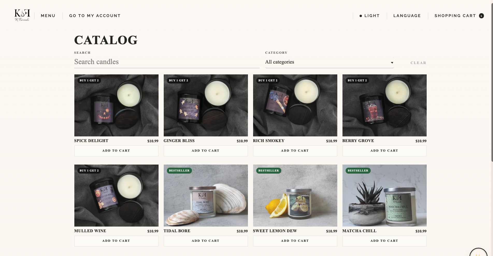
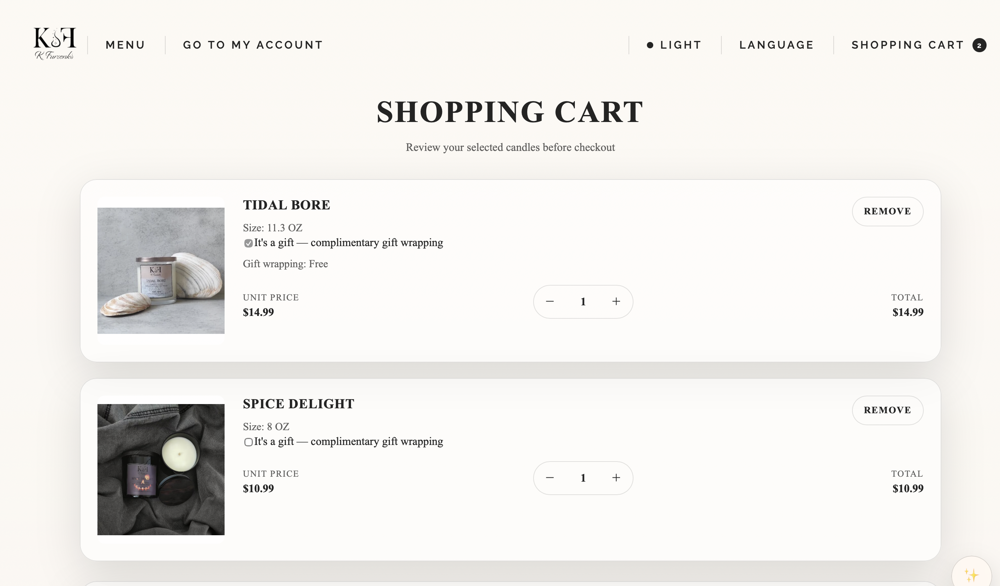

<div align="center">

# KFURSENKO CANDLES

**Full-stack e-commerce platform** for a handmade candle brand — React frontend + Django REST API backend, deployed live, taking real card payments and buying real shipping labels.

[](https://kfursenko.com/)
[](https://github.com/kseniiaross/KFursenko-candles-store/actions)

[](./LICENSE)

[Live Demo](https://kfursenko.com/) · [Backend](./backend) · [Frontend](./frontend)

</div>

---

## Overview


KFursenko Candles is a full-stack storefront for a one-person candle studio, built with a **Django REST API** and a **React/TypeScript SPA**. It handles real money — live Stripe payments, live USPS shipping rates, automatic refunds for payments the shop can't honour — and every one of those paths is covered by an automated test suite running on the same database as production.

This isn't a tutorial clone. It's a deployed shop with the awkwardness that comes with that: a discount engine where a seasonal campaign, a buy-two-get-three offer and a sign-up discount all compete for the same candle; shipping priced by packing the actual jars into actual boxes and asking the carrier; guest carts that survive signing in and tell you what changed; and a checkout that has to stay correct when Stripe redelivers the same notification three days later.

> **[kfursenko.com](https://kfursenko.com/)**

---

## Tech Stack

<table>
<tr>
<td valign="top" width="50%">

### Backend
- **Django 6** + **Django REST Framework**
- **PostgreSQL**
- **Stripe** — PaymentIntents, webhooks, automatic refunds, dispute alerts
- **Shippo** — live USPS rates and label purchase
- **SimpleJWT** — token auth
- **drf-spectacular** — OpenAPI schema
- **Cloudinary** — media storage
- **DRF throttling** — on auth, orders and quoting endpoints

</td>
<td valign="top" width="50%">

### Frontend
- **React 18** + **TypeScript**
- **Redux Toolkit** — cart, auth, modal state
- **React Router**
- **react-i18next** — English, Russian, Spanish, French
- **Axios** — shared client with a serialized cart request queue
- **Vite**

</td>
</tr>
<tr>
<td valign="top">

### Quality & Tooling (Backend)
- **pytest** + **pytest-django**
- **PostgreSQL** for the test suite, not SQLite — see [Testing](#testing)
- **Docker Compose** for the local database

</td>
<td valign="top">

### Quality & Tooling (Frontend)
- **ESLint**
- **TypeScript** — `tsc --noEmit` type checking
- **Playwright** — browser verification and randomized stress ("monkey") testing

</td>
</tr>
</table>

**Deploys** are automatic from `main`: Railway for the API and PostgreSQL, with migrations run on every deploy, plus a scheduled worker; Vercel for the SPA. Work lands on a branch and reaches production through a merged pull request, not a direct push.

---

## Key Features

**Storefront**



- Catalog by category and collection, with size variants priced per variant
- Every displayed price comes from the same engine the checkout charges with — the catalog card, the size picker, the product page, the cart and the stored order all call one function
- Offer badges driven entirely from the admin, including a personal sign-up discount that lowers the price without showing a badge to shoppers who don't qualify
- A scent recommendation quiz and an in-page assistant
- Four languages

**Pricing & offers**



- One pricing engine resolves three kinds of offer against the same basket: a seasonal campaign, a "buy two, get three" reward offer, and a first-order sign-up discount
- Reward groups: the two candles that qualify and the free candle can be different products, configured in the admin rather than in code
- Free units are assigned by price — dearest-first, cheapest free — and stored per line, so an order line can hold both free and paid units
- The sign-up discount falls through to any line a campaign left with nothing, and never stacks on a line that paid toward a free candle
- A cart prompt tells the shopper what adding one more candle would change, including when the total would go **up**, with both figures shown

**Shipping**

- Rates quoted live from USPS through Shippo at checkout, not estimated
- The server packs the order into real parcels — per-variant weight and dimensions, two box sizes with tare weights — and asks the carrier what that costs
- The rate token the storefront sends only names the service the shopper picked; **the order is always re-quoted server-side** against its own lines and address, so a token quoted for one candle can't pay the shipping on fifty, and the stored rate always belongs to the address the order ships to
- If the carrier API is unreachable, checkout falls back to a flat rate rather than failing — a shipping outage never stops a customer paying

**Cart & Checkout**


- Guest cart in localStorage that merges into the account cart at sign-in, line by line, and reports what it changed: a sold-out candle removed, a quantity lowered to what's left — shown to the shopper rather than silently dropped
- Cart requests are serialized through a queue, so a slow early response can't overwrite a later one across fast clicks or two open tabs
- All pricing computed server-side; the client never sends a price
- Stock is reserved when the order is created and released if it isn't paid for; a scheduled job expires abandoned orders every 15 minutes
- `SELECT FOR UPDATE` row locking on the order and on stock, scoped so Postgres will accept it

**Payments**

- Stripe PaymentIntents with webhook-driven order transitions, idempotent against Stripe's at-least-once delivery and multi-day retries
- A redelivered "payment succeeded" can never roll an order backwards; shipped and completed orders are left alone
- **First matching payment wins:** if checkout replaced an intent while an old payment form was still open, a payment on that old intent still pays the order, and the other intent is cancelled — money is never taken and dropped
- Amount and currency are verified against the order total before it is marked paid
- A payment the order can't honour — after cancellation, after refund, or for the wrong amount — is **refunded automatically**, recorded as a `PaymentIncident` visible in the admin, and alerted on
- Refunds come from Stripe, not the admin: `charge.refunded` moves the order and restores stock, so the shop's status can't claim money went back when it didn't
- Disputes are logged and alerted

**Account & Orders**

- JWT authentication, with rate limiting on login, registration and order creation
- Order history showing per-line discounts and free units as they were charged, read from stored values rather than recalculated
- Self-serve cancellation within the published window
- Admin: orders, offers with schedules and reward groups, payment incidents, stock by variant

---

## Testing

Testing here isn't a checkbox — it's how the most serious bug in this codebase was found, after it had been live and invisible since the first commit. For the money-moving paths, a test had to be shown failing against the old code before a fix was accepted.

| Layer | Tool | Coverage | Status |
|---|---|---|---|
| **Backend** | pytest on **PostgreSQL** | 463 tests — orders & lifecycle, Stripe webhooks/refunds/incidents, the pricing engine, shipping quotes & parcels, cart limits & merge, catalog, offers | ✅ passing |
| **Browser verification** | Playwright (Chromium) | Sign-in cart merge, offer modals, checkout flow, overlay stacking — including before/after pixel comparison between two running builds | ✅ passing |
| **Stress test** | Playwright + API fuzzing | Rapid clicks, two-tab conflicts, malformed bodies against every endpoint, mid-flow failures | ✅ passing |
| **Type checking** | `tsc --noEmit` | Whole frontend | ✅ 0 errors |
| **Lint** | ESLint | Whole frontend | ✅ 0 errors |

### Why the suite runs on PostgreSQL

It used to run on SQLite, which **silently ignores row locks**. The checkout locked an order row with a query that also joined a shipping record that doesn't exist until after payment — and PostgreSQL refuses `FOR UPDATE` on the nullable side of an outer join. Every checkout in production returned a 500. Three hundred tests passed, and not one of them could see it, because SQLite happily ran the query the production database rejected.

The suite now creates and drops its own database in the Docker Compose Postgres service by default (`TEST_DB=sqlite` still works for a quick run without Docker, and is documented as unable to catch this class of bug).

### What's actually exercised

- **The money path, end to end:** basket → price preview → order creation with stock reservation → PaymentIntent → webhook → paid, including duplicate delivery, out-of-order events, wrong amounts, replaced intents and payments arriving after cancellation or refund.
- **Refund direction:** a refund made in the Stripe dashboard moves the order and restores stock; marking an order refunded by hand is refused, so status and money can't disagree. Partial refunds record the running total without changing status or stock.
- **The pricing engine, as a unit and end to end:** campaign vs reward vs sign-up discount precedence, free-unit assignment and tie-breaking, line-level totals and labels, and the rule that the storefront price equals the charged price for every basket shape tested.
- **Shipping correctness:** parcel packing by weight and box size, re-quoting an order against its own lines, refusing a rate token from a different quote, quantity caps, and the flat-rate fallback when the carrier is unreachable.
- **Cart correctness in both modes:** guest and authenticated, per-line merge at sign-in with adjustments reported, quantity caps shared with order creation, and concurrent adds from two sessions.
- **Error statuses:** every endpoint probed with empty, oversized, wrong-typed and hostile input — asserting a 400 or 404 with a message the shopper can act on, never a 500 and never anything naming a file, a query or a key.

> **The stress test** drives the app with a fake Stripe and a fake Shippo so no live key is ever touched, then hammers it: the same candle added ten times as fast as the UI allows, quantity changed while a price preview is in flight, the cart emptied in a second tab mid-checkout, the carrier taken offline halfway through, and every API body replaced with junk. Its first run found an endpoint that would allocate ~140 million objects from a single request and kill the worker.

### Bugs found and fixed through testing

A few examples from [`docs/AUDIT.md`](./docs/AUDIT.md) and [`docs/CHANGELOG.md`](./docs/CHANGELOG.md):

- **The shop could not take a payment, and had never been able to.** `create-intent` locked the order while left-joining its shipment; PostgreSQL rejects that, so every checkout returned a 500 telling the shopper to check their information. The test suite ran on SQLite, which ignores row locks, so 300 green tests had never exercised the query production actually runs. Fixed by locking only the order row — and by moving the whole suite onto PostgreSQL, with a regression test shown failing on the old code first.
- **The catalog advertised one price and the checkout charged another.** The storefront and the checkout each computed discounts with their own code, so a seasonal offer showed $16.64 on the card and billed $18.49. Rewritten as a single pricing engine that the catalog, cart, checkout, price preview and stored order all call; the two can no longer disagree because there is nothing left to disagree with.
- **One request could kill a server worker.** The shipping-rates endpoint had no cap on quantity and called `int()` on unvalidated input. A quantity of 10⁹ made the parcel builder construct ~140 million dictionaries — an out-of-memory kill from a single unauthenticated request. Now validated and capped against the same limit order creation uses, so the two can't drift apart.
- **A paid order could be silently dropped.** If checkout replaced a PaymentIntent — which it does when Stripe can't be reached — a payment on the old intent matched no order: money taken, order left pending, nothing recorded, and the order later expired by the cleanup job while the shopper's tab said "Payment successful". Now the first matching payment pays the order and the other intent is cancelled.
- **Signing in could empty your cart.** The merge only ran on a page reload, not at sign-in, and the guest copy was cleared before the merge succeeded. One unavailable line refused the whole merge, and the frontend then deleted the guest cart without a word. Now it merges what it can, says what it changed, and clears the guest copy only after the server confirms.
- **An error message told shoppers to edit a Python file.** An unrecognised country produced `Unsupported country: 'X'. Add it to shipping.normalize.COUNTRIES.` — an internal module path, shown to the customer. Found by probing every endpoint with hostile input, along with four 500s that should have been 400s.
- **Every modal on the site could be drawn over by the header.** Not a z-index number but a stacking context: the page body established its own, so no value inside it could ever beat the fixed header. Fixed by rendering the overlays through portals, then verified by pixel-comparing all four against the previous build.

---

## Audit

The codebase was put through a full audit — backend and frontend read end to end — producing ranked findings recorded in [`docs/AUDIT.md`](./docs/AUDIT.md) and [`docs/AUDIT_FRONTEND.md`](./docs/AUDIT_FRONTEND.md), with every change logged in [`docs/CHANGELOG.md`](./docs/CHANGELOG.md).

Not every finding survived contact with the code, and the reversals are documented too — including one where a claimed mismatch between an offer badge and a page turned out to be the page's route that was missing, not the link that was wrong.

### Known limitations

Deliberately open, and documented rather than hidden:

- **International shipping** — rates quote, but customs declarations aren't generated, so shipping is US-only in practice
- **Sales tax** — filed manually by the owner; Stripe Tax is not wired up
- **Labels** — purchased through Shippo but not archived to Cloudinary
- **Tracking** — Shippo tracking webhooks aren't connected; tracking numbers are entered from the admin
- **Staging** — there is no second environment yet; changes are verified against a throwaway clone of the production catalog locally, then merged through a pull request

### How the work was done

The audit and the fixes were done with AI assistance — Claude for review, Claude Code for implementation — under a process designed to keep the output verifiable:

- **One task, one prompt, one commit.** Every prompt fixed the scope and named the acceptance checks (pytest on Postgres, `tsc --noEmit`, ESLint, a production build).
- **Tests had to fail first.** A fix touching money was accepted only once its test was shown failing against the pre-fix code. Two fixes were additionally verified by *reverting the rule and confirming the tests went red*, so a passing suite couldn't be mistaken for a working one.
- **Investigate before changing.** Anything ambiguous started read-only: what does the code actually do, and why. Several reported problems turned out to be different problems than reported.
- **Options before decisions.** Where a change had a product consequence — which offer wins on a candle, whether a payment on a stale intent is accepted or refunded — the alternatives were laid out with the prices each produces, in a table, before one was chosen. One option was rejected because it made a basket cost **more** after adding a free candle.
- **Browser verification for what tests can't prove:** overlay behaviour, the sign-in merge, the live Stripe payment form, pixel comparison between builds.
- **Product and policy decisions stayed human:** card payments only (no Klarna or Link), refunds initiated in Stripe rather than the admin, offer precedence by kind, and the 24-hour cancellation window.

---

## Getting Started

### Prerequisites
- Python 3.12+, Node 22+, Docker (for the test database)

### Backend
```bash
cd backend
python -m venv .venv && source .venv/bin/activate
pip install -r requirements.txt
cp .env.example .env      # SECRET_KEY, DB credentials, Stripe test keys, Shippo test token
python manage.py migrate
python manage.py runserver
```

### Frontend
```bash
cd frontend
npm install
cp .env.example .env      # VITE_API_URL, Stripe publishable key
npm run dev
```

### Running the test suite

```bash
# Backend — needs the Postgres container
docker compose up -d db
cd backend
pytest                       # 463 tests, on PostgreSQL
TEST_DB=sqlite pytest        # quick run without Docker; cannot catch locking bugs

# Frontend
cd frontend
npx tsc --noEmit             # type check
npm run lint                 # ESLint
npm run build                # production build
```

---

## Project Structure

```
KFursenko-candles-store/
├── backend/                      Django REST API
│   ├── accounts/                  Auth, profiles
│   ├── candles/                    Catalog, variants, collections, offers
│   ├── cart/                        Server cart, guest-cart merge
│   ├── orders/                       Orders, pricing engine, Stripe webhooks, refunds
│   │   ├── discounts.py               Campaign / reward / welcome resolution
│   │   ├── views_stripe.py             PaymentIntents and webhook handling
│   │   └── payments.py                  Automatic refunds and incident records
│   ├── shipping/                     Shippo client, parcel packing, rate quoting
│   ├── newsletter/                    Subscriptions
│   ├── lumiere/                        In-page assistant
│   └── config/                          Settings, test settings, parsers
├── frontend/                     React + TypeScript SPA
│   └── src/
│       ├── api/                        Axios client and endpoints
│       ├── components/                  Price, modals, shipping rates, offer prompts
│       ├── pages/                        Catalog, cart, checkout, orders, offer pages
│       ├── store/                         Redux slices
│       ├── hooks/                          Cart hydration, price preview
│       └── i18n.ts                          Four languages
└── docs/                         Audit reports, changelog, screenshots
```

---

## License

MIT — see [LICENSE](./LICENSE) for details.

---

<div align="center">

Built by [Kseniia Rostovskaia](https://kseniiaross.dev)

LinkedIn: https://www.linkedin.com/in/kseniia-rostovskaia

</div>